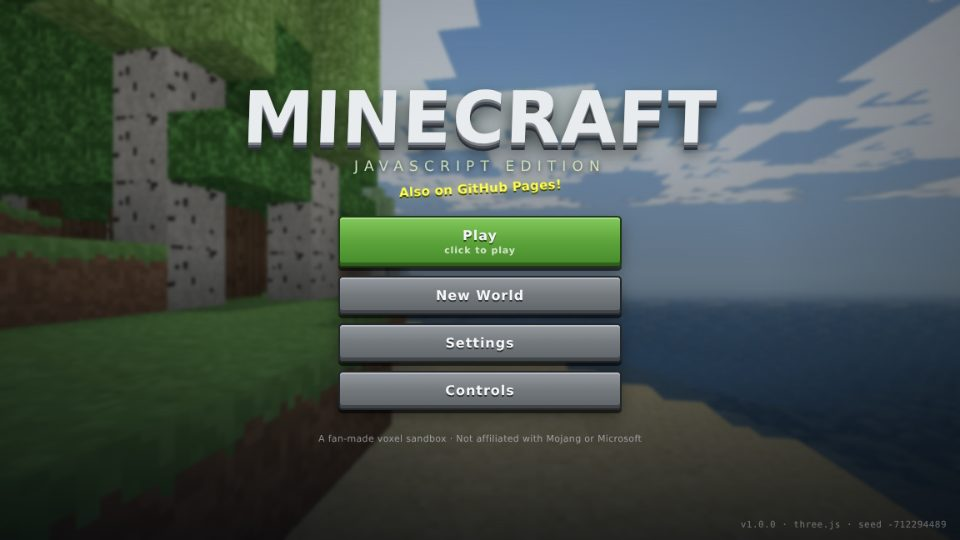

# Minecraft: JavaScript Edition

A fan-made, Minecraft-style voxel sandbox that runs entirely in the browser. No Java, no
build step, no bundler, no server-side code — just static files you can drop on GitHub Pages.


**▶ Play:** <https://pythonEaterBoi.github.io/Minecraft-javascript-edition/>

If that link is not live yet, enable GitHub Pages once (see
[Deploying to GitHub Pages](#deploying-to-github-pages)); the site is deployed from `main`.
You can also run the game locally with any static file server —
see [Running locally](#running-locally).

## Contents

- [What you can do](#what-you-can-do)
- [Controls](#controls)
- [Running locally](#running-locally)
- [Deploying to GitHub Pages](#deploying-to-github-pages)
- [How it works](#how-it-works)
- [Project layout](#project-layout)
- [Saved data](#saved-data)
- [Performance tips](#performance-tips)
- [Browser support](#browser-support)
- [Credits](#credits)

## What you can do

- **Explore an endless procedural world** — rolling plains, forests, deserts, snowy tundra,
  mountains, beaches and oceans, generated from a seed you can type in.
- **Dig and build** — break and place 27 block types, with a hotbar, block picker and a
  block highlight on whatever you are looking at.
- **First-person movement** — walk, sprint, jump, swim, dive, and toggle creative flight.
- **Day and night** — a ten-minute cycle with sunsets, sunrises, stars, drifting blocky
  clouds and colour-matched fog.
- **Pick up where you left off** — the world, your inventory and your exact position are
  saved in `localStorage` (autosave every 20 seconds, plus on pause/quit).
- **Play on a phone or tablet** — on-screen joystick, drag-to-look and buttons for jumping,
  mining, placing, flying and the block picker.
- **Zero runtime downloads** — textures are painted procedurally into an atlas at boot, the
  sound effects are synthesized with the Web Audio API, and Three.js is vendored in the repo.



## Controls

### Desktop

| Input | Action |
| --- | --- |
| `W` `A` `S` `D` / arrow keys | Move |
| Mouse | Look around (click **Play** to capture the mouse) |
| Left click | Break block (hold to keep breaking) |
| Right click | Place block |
| Middle click | Pick the targeted block into the hotbar |
| `Space` | Jump · swim up · fly up |
| `Shift` | Sprint · fly down · dive while swimming |
| `F` | Toggle flight |
| `1` – `9`, mouse wheel | Select a hotbar slot |
| `E` | Open the block picker |
| `T` | Freeze / resume the day–night cycle |
| `F3` | Debug overlay (position, chunk, biome, FPS) |
| `Esc` | Pause (also releases the mouse) |

The **Settings** menu has render distance, mouse sensitivity, sound, clouds and the
day/night cycle; settings are remembered between visits.

### Touch

- **Left joystick** — move (push all the way to sprint).
- **Drag anywhere on the right** — look around.
- **Jump**, **Down**, **Mine**, **Place**, **Fly**, **Blocks**, **Menu** buttons on the right.

## Running locally

The game is plain ES modules, so it needs to be served over HTTP (opening `index.html`
from `file://` will be blocked by the browser's module rules). Any static server works:

```bash
# Python 3
python3 -m http.server 8080

# or Node
npx serve .
```

Then open <http://localhost:8080>. There is nothing to install and nothing to compile:
edit a file, refresh the page.

## Deploying to GitHub Pages

1. Push this repository to GitHub (branch `main`).
2. Open **Settings → Pages** in the repository.
3. Under **Build and deployment**, set **Source** to **Deploy from a branch**.
4. Choose branch **`main`** and folder **`/ (root)`**, then **Save**.
5. Wait for the first deployment and open
   <https://pythonEaterBoi.github.io/Minecraft-javascript-edition/>.

Everything is committed in the form Pages needs:

- **`.nojekyll`** is present so Jekyll does not touch the files.
- All paths are **relative** (`./src/main.js`, `../vendor/three/...`), so the game also works
  from a project sub-path such as `/Minecraft-javascript-edition/`.
- There are **no build artefacts** to publish and no CDN requests to allow — the complete
  game, including Three.js, is in the repository.

## How it works

| Layer | Notes |
| --- | --- |
| Rendering | Three.js **r187** (vendored ESM build) with `MeshBasicMaterial`s; lighting is baked into vertex colours. |
| World | 16 × 128 × 16 chunks in a `Uint8Array`, generated on demand around the player and meshed in the background. |
| Meshing | One buffer per chunk per material class (opaque, water, glass). Faces get directional shading, ambient occlusion and a sky-depth term so caves and cliffs read without a light engine. |
| Terrain | Value-noise height fields with biomes, beaches, caves, ore veins and trees; everything is derived deterministically from the seed. |
| Textures | A 256 × 256 atlas painted at boot with 2D canvas — no image files, no network requests. |
| Player | Axis-aligned bounding box with swept collision, walking/sprinting/jumping, swimming and creative flight. |
| Sky | Gradient dome with sun, moon, stars, clouds on a drifting plane, plus fog that matches the horizon. |
| Audio | Short synthesized effects (dig, place, step, click) built with oscillators and noise buffers. |
| Persistence | One save slot in `localStorage`: seed, time, position, rotation, hotbar and block edits. |

## Project layout

```
index.html              page shell, UI screens and touch controls
styles/main.css         all UI styling (responsive, reduced-motion aware)
src/main.js             Game class: renderer, loop, state machine, save/load
  src/core/             noise and hashing helpers
  src/world/            blocks, atlas, chunks, terrain generation, mesher
  src/player/           input, physics, raycasting
  src/render/           sky dome, clouds, fog
  src/ui/               menus, HUD, hotbar, inventory, settings
  src/audio/            Web Audio sound effects
vendor/three/           Three.js r187 (MIT) + licence
screenshots/            images used by this README
```

## Saved data

| Key | Contents |
| --- | --- |
| `mje.save.v1` | Seed, time of day, player position/rotation, flight state, hotbar and block edits. |
| `mje.settings.v1` | Render distance, sensitivity and the sound/clouds/day-cycle toggles. |

**New World** replaces the current save; **Save & Quit to Title** writes it immediately.
Clearing site data in the browser starts over with the default seed.

## Performance tips

- Lower **Render distance** first — it is the single biggest win (10 is the maximum, 7 the
  desktop default, 5 on touch devices).
- Turn off **Clouds** on very old machines; they are a full-screen transparent layer.
- The game renders at up to 2× device pixel ratio (1.5× on touch), so a high-DPI phone is
  doing more work than it looks like.

## Browser support

Any browser with **WebGL 2** and ES modules: current Chrome, Edge, Firefox and Safari
(desktop and mobile). If WebGL is unavailable the page shows a readable explanation instead
of a blank canvas. Pointer lock is used on desktop; touch devices get the on-screen controls.
`prefers-reduced-motion` is respected by the menus and animations.

## Credits

- Built with [Three.js](https://threejs.org/) r187 — MIT licence, see `vendor/three/LICENSE`.
- All textures, terrain and audio are generated in code; there are no third-party assets.
- Minecraft is a trademark of Mojang Studios / Microsoft. This is a non-commercial fan
  project and is not affiliated with or endorsed by Mojang or Microsoft.
