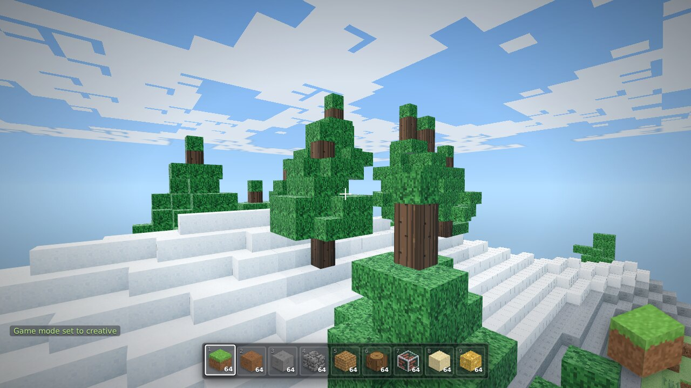
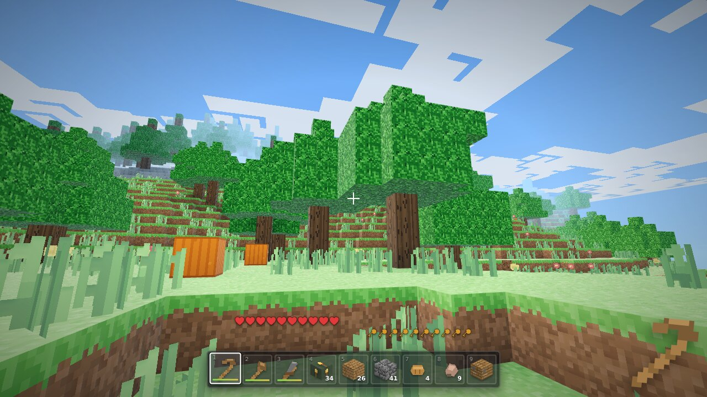
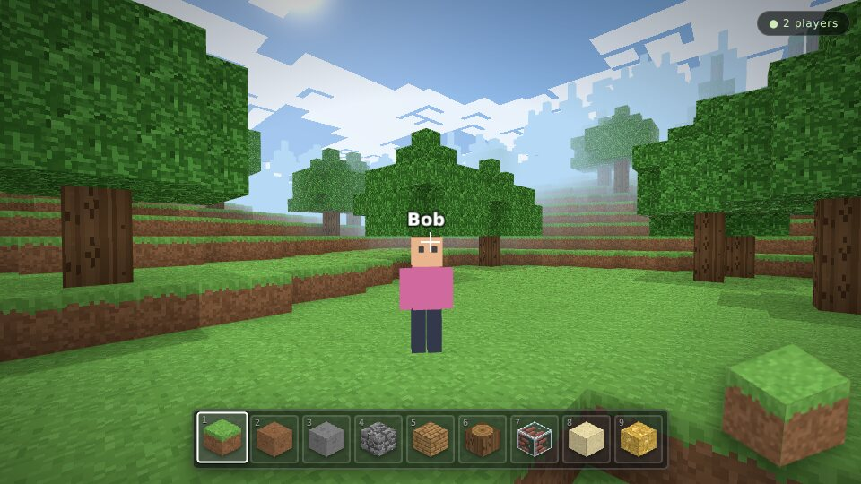
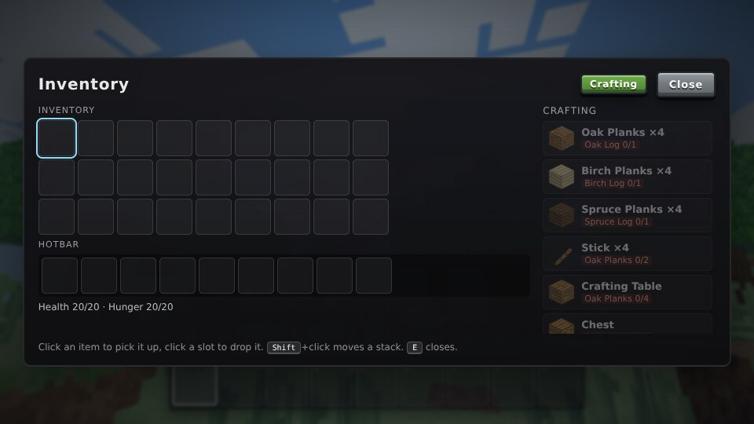
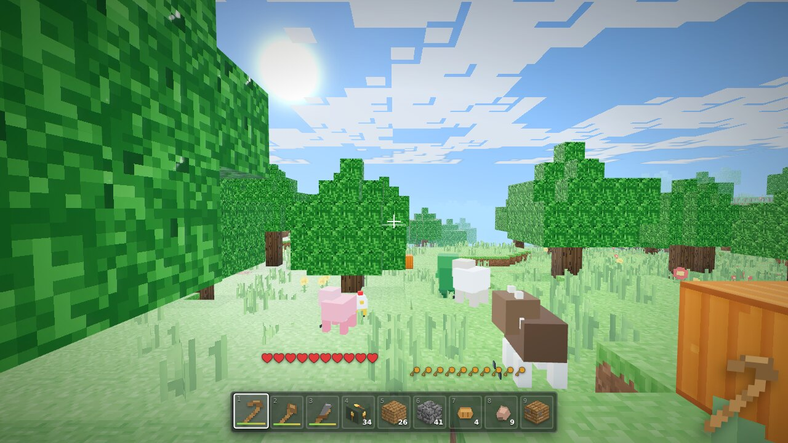
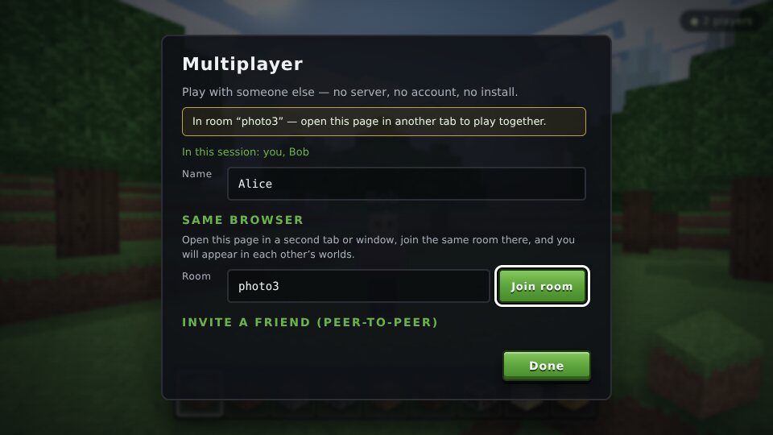

# Minecraft: JavaScript Edition

A fan-made, Minecraft-style voxel sandbox that runs entirely in the browser. No Java, no
build step, no bundler, no server-side code — just static files you can drop on GitHub Pages.
Mine, craft, smelt, farm mobs, hunt for ore, keep your hunger bar full, type `/commands`,
chat with other players — and play together over same-browser rooms, serverless
peer-to-peer invites or the built-in server browser.



**▶ Play:** <https://pythonEaterBoi.github.io/Minecraft-javascript-edition/>

If that link is not live yet, enable GitHub Pages once (see
[Deploying to GitHub Pages](#deploying-to-github-pages)); the site is deployed from `main`.
You can also run the game locally with any static file server —
see [Running locally](#running-locally).

## Contents

- [What you can do](#what-you-can-do)
- [Survival](#survival)
- [Crafting, smelting and containers](#crafting-smelting-and-containers)
- [Tools, ores and mining](#tools-ores-and-mining)
- [Commands and chat](#commands-and-chat)
- [Visuals: PBR textures and vibrance](#visuals-pbr-textures-and-vibrance)
- [Servers](#servers)
- [Multiplayer](#multiplayer)
- [Controls](#controls)
- [Running locally](#running-locally)
- [Deploying to GitHub Pages](#deploying-to-github-pages)
- [How it works](#how-it-works)
- [Project layout](#project-layout)
- [Saved data](#saved-data)
- [Performance tips](#performance-tips)
- [Browser support](#browser-support)
- [Credits](#credits)

## What you can do

- **Explore an endless procedural world** — plains, forests, deserts, snowy tundra, mountains,
  beaches and oceans, generated from a seed you can type in. Caves and cliffs are full of
  coal, copper, iron, gold, redstone, lapis, diamond and emerald ore.
- **Survive** — 20 health, a hunger bar that drains as you sprint, jump and fight, fall
  damage, drowning, starvation and mob attacks. Health regenerates while you stay fed.
- **Craft and smelt** — 66 recipes and 15 smelting recipes. Craft a crafting table to unlock
  the full grid, build a furnace to cook meat and melt ore into ingots, and store everything
  in chests.
- **Use real tools** — wooden, stone, iron, gold and diamond pickaxes, axes, shovels and
  swords, each with its own speed, durability and damage. Ore tiers gate what you can mine.
- **Hunt and cook** — pigs, cows, chickens and sheep drop meat and materials; cook raw meat in
  a furnace before eating it. Zombies come out at night and hit back.
- **Build with 91 block types** — ores, planks, wool, glass, ice, amethyst, quartz, lanterns,
  pumpkin, melon and more, all painted at boot into the texture atlas.
- **Talk and cheat** — press `T` to chat, or type `/help` for around twenty commands
  (`/gamemode`, `/give`, `/time`, `/tp`, `/setblock`, `/summon`, `/pbr`, `/vibrant`, …).
- **Look good doing it** — a PBR material set (normal, roughness and metalness maps plus a
  procedural environment map) with a vibrant colour grade, or a fast unlit mode on old
  hardware.
- **First-person movement** — walk, sprint, jump, swim, dive, and toggle creative flight.
- **Day and night** — a ten-minute cycle with sunsets, sunrises, stars, drifting blocky
  clouds and colour-matched fog.
- **Pick up where you left off** — world, position, inventory, containers, gamemode and mobs
  are saved in `localStorage` (autosave every 20 seconds, plus on pause/quit).
- **Play with a friend** — join a room in a second tab, send a peer-to-peer invite code to
  someone on the other side of the internet, or scan the LAN-style server browser.
- **Never need a mouse** — the whole game, including the menus, is playable from the keyboard.
- **Play on a phone or tablet** — on-screen joystick, drag-to-look and buttons for jumping,
  mining, placing, flying and the block picker.
- **Zero runtime downloads** — textures are painted procedurally into an atlas at boot, the
  PBR maps are derived from that atlas, sound effects are synthesized with the Web Audio API,
  and Three.js is vendored in the repo.





## Survival

A new world starts in **survival** mode. `/gamemode creative` (or `/gm c`) flips back to the
old sandbox — creative players fly, never take damage and never drain hunger.

| Stat | Behaviour |
| --- | --- |
| Health | 20 points (10 hearts). Regen kicks in after 3.5 s without damage while hunger is at least 18. |
| Hunger | 20 points, drained by walking, sprinting, jumping and fighting. At zero you starve slowly. Eating food (hold a food item and use it) refills hunger and saturation. |
| Air | 10 bubbles while submerged; running out costs health. |
| Fall damage | Anything above about three blocks hurts, scaled by the height you fell. |

- **Death** shows a death screen (`Enter` or `Space` respawns at the world spawn) and keeps
  your inventory — this is a sandbox, not a punishing one.
- **Mobs** — pigs, cows, chickens and sheep wander in daylight and drop meat, leather,
  feathers and wool. Zombies spawn in the dark, chase you within 18 blocks and deal 3 damage
  per hit. Up to 14 mobs are alive at once; they despawn when you walk away.
- **Press `F3`** to see health, hunger and the mob count while testing.

## Crafting, smelting and containers

Press `E` for the inventory: 36 slots, your hotbar, and the recipe book. Recipes are shown
greyed out until you have the ingredients, so it doubles as a goal list. Click a recipe to
craft it (shift-click crafts as many as it can).

| Container | How it works |
| --- | --- |
| Crafting table | Place it, then right-click (`B`) it to open the 3×3 grid. The first recipes (planks, sticks, a crafting table) can be hand-crafted from the inventory. |
| Furnace | Place it, open it, and put fuel in the top slot and ore or raw food in the bottom. One smelt takes 9 seconds; coal, charcoal, planks and sticks all burn. |
| Chest | Place it and open it for 27 slots. Contents are saved with the world, and on a multiplayer host they are sent to everyone who opens them. |



## Tools, ores and mining

Hold the left mouse button (or `V`) to mine. Each block has a hardness and each tool a
speed, so the right tool is dramatically faster; using the wrong one costs you.

| Tier | Pickaxe speed | Durability | Sword damage |
| --- | --- | --- | --- |
| Wood | 2× | 59 | 6 |
| Stone | 4× | 131 | 7 |
| Iron | 6× | 250 | 8 |
| Gold | 12× | 32 | 7 |
| Diamond | 8× | 1561 | 9 |

Ores are tiered like the real thing: coal and copper only need wood, iron and lapis need
stone, gold, redstone, diamond and emerald need iron. Ores are placed in veins by depth, so
dig down (and bring torches) to find the good stuff. Broken blocks drop themselves or their
items — stone gives cobblestone, ores give raw material, grass gives dirt.

## Commands and chat

Press `T` (or `/`) to open chat, type, and press `Enter`. Anything starting with `/` is a
command; everything else is chat and is relayed to the other players in your session.

| Command | What it does |
| --- | --- |
| `/help` | List every command |
| `/gamemode <survival\|creative>` · `/gm` | Switch mode (creative fills an empty hotbar) |
| `/time set <day\|noon\|sunset\|night\|midnight\|sunrise\|0-1>` · `/time add <n>` | Move the clock |
| `/tp <x> <y> <z>` · `/teleport` | Teleport |
| `/give <item> [count]` | Items and blocks, by name (`/give wooden_pickaxe 1`, `/give chest`), fuzzy match or id |
| `/clear` | Empty the inventory |
| `/kill` · `/heal` · `/feed` | Damage, heal or feed yourself |
| `/spawn` | Teleport back to the world spawn |
| `/seed` · `/list` · `/mobs` | World seed, session player list, mob count |
| `/summon <mob> [x y z]` | Spawn a mob where you are looking |
| `/setblock <x> <y> <z> <block>` | Place a block (and share it in a session) |
| `/say <text>` · `/me <action>` | Chat with a different prefix |
| `/pbr <on\|off>` · `/vibrant <on\|off>` | Toggle the renderer's look |
| `/fly` | Toggle flight |

## Visuals: PBR textures and vibrance

The atlas is painted at boot, so the PBR maps are derived from it in the same pass: a normal
map from the luminance gradient of every tile, a roughness map from the material's shininess
and a metalness map from the same table. Metals, ice and water get a procedural environment
map (a small equirectangular gradient run through `PMREMGenerator`) so they actually reflect
something, and terrain geometry carries per-face normals and tangents for the normal map.

- **Settings → PBR textures** switches between the lit `MeshStandardMaterial` set and the
  original unlit `MeshBasicMaterial` set. The unlit path is much cheaper and looks exactly
  like the pre-PBR game.
- **Settings → Vibrant colours** applies a saturation/contrast grade (`body.vibrant`).
- Both are remembered, and both have chat commands (`/pbr`, `/vibrant`) for quick comparison.

## Servers

The **Servers** screen (title screen, pause menu or `Esc` → Servers) is a server browser for
peer-to-peer sessions, since there is no backend to run a real one:

- **Scan** listens on a `BroadcastChannel` discovery channel and lists every room that another
  tab of the same browser is hosting, with its room name, player count and host name.
- **Save** remembers the current room locally (up to 12), so you can jump back into it from a
  list instead of retyping the name.
- **Join** connects to the room — identical to joining it from the Multiplayer screen.

Because rooms live in `BroadcastChannel`, they reach tabs of the same browser. For a friend on
another machine, use the WebRTC invite flow from the Multiplayer screen.



## Multiplayer

Open **Multiplayer** from the title screen or the pause menu. Both players keep their own
name (remembered in `localStorage`) and see a box avatar with a name tag above the head.



### Same browser (rooms)

Two tabs or windows of the same browser can play together with no setup at all:

1. In one tab: **Multiplayer** → type a room name → **Join room**.
2. In the second tab: **Multiplayer** → the same room name → **Join room**.
3. The second tab loads the first tab's world — same seed, same block edits, same time of day.

Rooms use `BroadcastChannel`, so they only reach tabs of the same browser on the same
machine. For anything further away, use an invite.

### Across the internet (peer-to-peer)

The invite flow is a direct WebRTC connection — no server relays your world, and nothing is
uploaded anywhere. The "codes" are base64 SDP blobs, so they are long — that is normal.

1. **Host:** *Create invite code* and copy the code it shows.
2. Send that code to your friend however you like (chat, email, carrier pigeon).
3. **Friend:** paste it under *Joining a friend?* and press **Create answer code**.
4. The friend sends the answer code back.
5. **Host:** paste it under *2 · Paste your friend's answer code* and press
   **Finish connection**.
6. Both screens show *Connected* and you are in the same world.

If a connection cannot be established, one of the two networks is probably blocking direct
peer traffic (symmetric NAT); the game tries a public STUN server but there is no TURN relay
to fall back on.

### What is shared

| Shared | Details |
| --- | --- |
| World | The host's seed and every block edit are sent when you join, and edits made by either player afterwards appear for both. |
| Players | Position, look direction and flight state, ten times a second, drawn as interpolated avatars. |
| Time of day | The host owns the clock, so sunsets line up. |
| Names | Each player's chosen name, shown above their avatar and in the session list. |

Sessions are temporary by design: joining someone else's world does not touch your own
save, and your single-player world is exactly as you left it when you leave. The **● n
players** badge in the corner shows the session size; **Leave session** in the multiplayer
menu tears it down.

## Controls

### Desktop

| Input | Action |
| --- | --- |
| `W` `A` `S` `D` | Move |
| `←` `→` `↑` `↓` | Look around (keyboard look) |
| Mouse | Look around (click **Play** to capture the mouse) |
| Left click | Break block (hold to keep breaking) |
| Right click | Place block |
| Middle click | Pick the targeted block into the hotbar |
| `V` | Break block (keyboard) — tap or hold |
| `B` | Place block, open a container, or use/eat the held item (keyboard) |
| `Space` | Jump · swim up · fly up |
| `Shift` | Sprint · fly down · dive while swimming |
| `F` | Toggle flight |
| `1` – `9`, mouse wheel | Select a hotbar slot |
| `E` | Inventory, crafting and containers |
| `T`, `/`, `Enter` | Chat — start with `/` for a command |
| `Q` | Drop the held item |
| `F6` | Freeze / resume the day–night cycle |
| `F3` | Debug overlay (position, chunk, biome, FPS, mobs) |
| `Esc` | Pause (also releases the mouse) |

The arrow keys turn the camera, so the whole game is playable without touching the mouse:
walk with `WASD`, look with the arrows, dig with `V`, build with `B`.

The **Settings** menu has render distance, mouse sensitivity, sound, clouds and the
day/night cycle; settings are remembered between visits.

### Menus from the keyboard

Every screen works without a mouse as well:

| Input | Action |
| --- | --- |
| `↑` `↓` / `←` `→` | Move between buttons and fields |
| `Home` / `End` | Jump to the first / last item |
| `Enter` / `Space` | Press the focused button |
| `Esc` | Close the menu or go back |
| `Enter` / `Space` (nothing focused) | Resume from the pause screen |

Focus is moved for you when a menu opens, so **Esc** then **Enter** resumes a paused game
without clicking, and the pause → **Multiplayer** screen is three arrow presses away.

### Touch

- **Left joystick** — move (push all the way to sprint).
- **Drag anywhere on the right** — look around.
- **Jump**, **Down**, **Mine**, **Place**, **Fly**, **Blocks**, **Menu** buttons on the right.

## Running locally

The game is plain ES modules, so it needs to be served over HTTP (opening `index.html`
from `file://` will be blocked by the browser's module rules). Any static server works:

```bash
# Python 3
python3 -m http.server 8080

# or Node
npx serve .
```

Then open <http://localhost:8080>. There is nothing to install and nothing to compile:
edit a file, refresh the page.

## Deploying to GitHub Pages

1. Push this repository to GitHub (branch `main`).
2. Open **Settings → Pages** in the repository.
3. Under **Build and deployment**, set **Source** to **Deploy from a branch**.
4. Choose branch **`main`** and folder **`/ (root)`**, then **Save**.
5. Wait for the first deployment and open
   <https://pythonEaterBoi.github.io/Minecraft-javascript-edition/>.

Everything is committed in the form Pages needs:

- **`.nojekyll`** is present so Jekyll does not touch the files.
- All paths are **relative** (`./src/main.js`, `../vendor/three/...`), so the game also works
  from a project sub-path such as `/Minecraft-javascript-edition/`.
- There are **no build artefacts** to publish and no CDN requests to allow — the complete
  game, including Three.js, is in the repository.

## How it works

| Layer | Notes |
| --- | --- |
| Rendering | Three.js **r187** (vendored ESM build). PBR mode uses `MeshStandardMaterial` with sun/hemisphere/ambient lights and a procedural environment map; fast mode uses unlit `MeshBasicMaterial`s with lighting baked into vertex colours. |
| World | 16 × 128 × 16 chunks in a `Uint8Array`, generated on demand around the player and meshed in the background. |
| Meshing | One buffer per chunk per material class (opaque, water, glass, plants). Faces get directional shading, ambient occlusion and a sky-depth term; quads also carry normals and tangents so normal maps work, and crossed quads render plants and torches. |
| Terrain | Value-noise height fields with biomes, beaches, caves, ore veins, trees, plants and pumpkins; everything is derived deterministically from the seed. |
| Textures | A 256 × 256 atlas painted at boot with 2D canvas — no image files, no network requests. The PBR normal/roughness/metalness maps are derived from the same canvas. |
| Items | Blocks `0–90` and items `512+` share one id space; recipes, smelting, tools and food all live in `src/items/`. |
| Survival | `src/player/survival.js` owns health, hunger, air and damage; mobs live in `src/entities/mobs.js` and tick their own AI. |
| Containers | `src/world/blockentities.js` keeps chest and furnace state, runs the smelting timer, and serializes into the save. |
| Player | Axis-aligned bounding box with swept collision, walking/sprinting/jumping, swimming and creative flight. |
| Sky | Gradient dome with sun, moon, stars, clouds on a drifting plane, plus fog that matches the horizon. |
| Audio | Short synthesized effects (dig, place, step, click) built with oscillators and noise buffers. |
| Multiplayer | `BroadcastChannel` rooms for same-browser play and an `RTCDataChannel` for invite-based play. The host is authoritative for the world, edits and the clock; joiners adopt its seed and edit list. |
| Persistence | One save slot in `localStorage`: seed, time, gamemode, position, rotation, inventory, survival stats, block edits, containers and mobs. |

## Project layout

```
index.html              page shell, UI screens and touch controls
styles/main.css         all UI styling (responsive, reduced-motion aware)
src/main.js             Game class: renderer, loop, state machine, save/load
  src/core/             noise and hashing helpers
  src/world/            blocks, atlas, PBR maps, chunks, terrain generation,
                        mesher, chest/furnace state
  src/items/            ids, item + tool + food registry, icons, inventory,
                        recipes and smelting
  src/entities/         mobs (models, AI, drops, spawning)
  src/player/           input, physics, raycasting, survival stats
  src/render/           sky dome, clouds, fog
  src/ui/               menus, HUD, hotbar, inventory/crafting, containers,
                        chat, server browser, settings
  src/audio/            Web Audio sound effects
  src/net/              multiplayer session (rooms, WebRTC invites, chat and
                        container relay, discovery) and remote avatars
vendor/three/           Three.js r187 (MIT) + licence
screenshots/            images used by this README
```

## Saved data

| Key | Contents |
| --- | --- |
| `mje.save.v1` | Version 2 save: seed, time, gamemode, player position/rotation/flight, survival stats, inventory, block edits, container contents and up to 24 mobs. Version 1 saves still load. |
| `mje.settings.v1` | Render distance, sensitivity, sound/clouds/day-cycle toggles, PBR, vibrance and mobs. |
| `mje.name.v1` | The player name used in multiplayer. |
| `mje.servers.v1` | Up to 12 saved server (room) entries for the server browser. |

**New World** replaces the current save; **Save & Quit to Title** writes it immediately.
Clearing site data in the browser starts over with the default seed. Multiplayer worlds are
never written to the save slot.

## Performance tips

- Lower **Render distance** first — it is the single biggest win (10 is the maximum, 7 the
  desktop default, 5 on touch devices).
- Turn off **PBR textures** on integrated GPUs: the lit materials do real per-pixel lighting
  and sample three extra textures per fragment. The unlit mode is several times cheaper.
- Turn off **Mobs** if you only want to build; it stops the spawner and the AI ticks.
- Turn off **Clouds** on very old machines; they are a full-screen transparent layer.
- The game renders at up to 2× device pixel ratio (1.5× on touch), so a high-DPI phone is
  doing more work than it looks like.

## Browser support

Any browser with **WebGL 2** and ES modules: current Chrome, Edge, Firefox and Safari
(desktop and mobile). If WebGL is unavailable the page shows a readable explanation instead
of a blank canvas. Pointer lock is used on desktop; touch devices get the on-screen controls.
Multiplayer needs `BroadcastChannel` (rooms) or WebRTC data channels (invites) — both are
available in all of those browsers, but WebRTC invites require the page to be served over
`https://` or `localhost`, which GitHub Pages provides.
`prefers-reduced-motion` is respected by the menus and animations.

## Credits

- Built with [Three.js](https://threejs.org/) r187 — MIT licence, see `vendor/three/LICENSE`.
- All textures, terrain and audio are generated in code; there are no third-party assets.
- Minecraft is a trademark of Mojang Studios / Microsoft. This is a non-commercial fan
  project and is not affiliated with or endorsed by Mojang or Microsoft.
